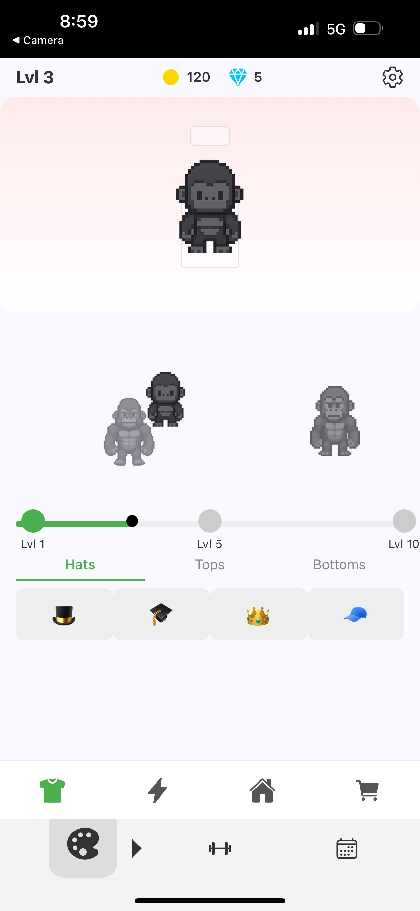

# FitPal

A workout companion where your progress helps a virtual gym buddy grow. Built with React Native and Expo, FitPal combines workout logging, character progression, and a playful gym interface.

I built this around a personal question: could tracking workouts feel rewarding in the moment, instead of being another spreadsheet to maintain?

## A look inside

<p>
  
  
</p>

*Screens from my project portfolio: the opening comic and character customization.*

## What is here

- Workout and routine screens, set logging, and history views.
- A virtual character, experience progression, equipment, and backgrounds.
- Local state providers for workouts, history, and progression.
- Firebase authentication integration and optional notification flows.

The interesting product decision is tying progression to training: a practical logging tool and a playful companion share the same interaction.

## Run locally

Use Node.js and an Expo-compatible Android/iOS environment:

```bash
npm ci
npx expo start
```

Follow Expo's terminal instructions to open the app on a device or emulator. The app targets Android and iOS. Firebase sign-in and provider-specific authentication require your own project configuration.

To check the Android JavaScript bundle without publishing a native app:

```bash
npx expo export --platform android
```

## Code map

`App.js` composes the providers and navigation. `src/screens/` contains the product views; `src/components/` holds shared UI. `src/context/` owns local state and authentication, and `src/data/` contains character and equipment definitions.

## Project status

The Android JavaScript bundle has been verified with Expo. Authentication and notifications require a configured development backend and device testing. Automated tests and a store release are future work.
